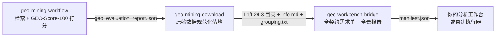

# GEO Mining Suite

一套面向 **NCBI GEO 公共转录组数据** 的 AI Agent 技能套件，把「找数据、落数据、进分析工作台」串成一条可复现的流水线。

三个技能共享同一套数据契约，可以单独使用，也可以首尾相接：



| 技能 | 输入 | 输出 | 作用 |
| :--- | :--- | :--- | :--- |
| [`geo-mining-workflow`](skills/geo-mining-workflow/) | 疾病或表型关键词 | `geo_evaluation_report.{md,tsv,json}` | 检索 GEO 候选集，按五个客观维度打 0 到 100 分，执行样本量与原始数据的硬性红线 |
| [`geo-mining-download`](skills/geo-mining-download/) | 上游报告 JSON，或指定 GSE | 标准目录、矩阵、SOFT、`info.md`、`grouping.txt` | 拉取 series matrix、平台注释、原始 counts，按 L1/L2/L3 规范归档，1GB 大文件默认拦截 |
| [`geo-workbench-bridge`](skills/geo-workbench-bridge/) | GSE、GPL、GSM 分组、先验基因 | 20 模块需求单 JSON、HTML 全景报告 | 判断课题轨道与靶点状态，装配完整分析 DAG，输出可导入工作台的需求单，并给出湿实验反哺建议 |

## 为什么是三个技能而不是一个

调研、落盘、建项是三件失败模式完全不同的事：

- 检索阶段最怕样本量不足和只有表达矩阵没有原始数据，所以需要硬性红线与确定性打分。
- 下载阶段最怕目录乱、大文件拖死网络、样本分组对不上，所以需要固定命名与 `info.md` 建档。
- 建项阶段最怕字段漏填导致界面复选框全空、项目 ID 非法、虚拟敲除缺靶基因，所以需要全契约装配与独立校验。

拆开之后每一步都能单独复用。比如你已经有 GSE 号，可以跳过第一步直接下载；你只想评估数据集质量，可以只跑第一步。

## 快速开始

环境要求：Python 3.10 及以上，Node.js 18 及以上（只有第三个技能需要 Node）。

```bash
git clone <your-repo-url> geo-mining-suite
cd geo-mining-suite
pip install -r skills/geo-mining-workflow/requirements.txt
pip install -r skills/geo-mining-download/requirements.txt
```

### 第一步：检索与打分

```bash
python skills/geo-mining-workflow/scripts/search_geo.py \
  --query "Diabetic Nephropathy" \
  --disease_zh "糖尿病肾病" \
  --species "Homo sapiens" \
  --retmax 15 \
  --export_dir eval_results
```

输出到 `eval_results/`，其中 `geo_evaluation_report.json` 是下一步的输入。

### 第二步：规范化下载

输出目录必须显式提供，脚本不会写死任何路径：

```bash
python skills/geo-mining-download/scripts/download_geo.py \
  --output-dir "/data/geo" \
  --report-json eval_results/geo_evaluation_report.json \
  --top-rank 1 \
  --disease-zh "糖尿病肾病" \
  --dry-run

python skills/geo-mining-download/scripts/download_geo.py \
  --output-dir "/data/geo" \
  --report-json eval_results/geo_evaluation_report.json \
  --top-rank 1 \
  --disease-zh "糖尿病肾病"
```

也可以直接指定数据集：

```bash
python skills/geo-mining-download/scripts/download_geo.py \
  --output-dir "/data/geo" \
  --gse GSE245825 \
  --gpl GPL18573 \
  --modality bulk_rnaseq \
  --disease-zh "示例疾病"
```

### 第三步：生成需求单

```bash
node skills/geo-workbench-bridge/scripts/generate_full_manifest.js \
  --input examples/demo-bulk/config.json \
  --out-dir build

node skills/geo-workbench-bridge/scripts/validate_manifest.js \
  build/manifest.json
```

校验器会检查 20 个契约模块、双命名一致性、DAG 步骤数、GSM 格式、靶基因与虚拟敲除的匹配关系。输出 `PASS` 才算可导入。

## 目录结构

```text
geo-mining-suite/
├── skills/
│   ├── geo-mining-workflow/
│   │   ├── SKILL.md
│   │   ├── PROMPT_TEMPLATE.md
│   │   ├── requirements.txt
│   │   ├── config/
│   │   ├── scripts/
│   │   └── references/
│   ├── geo-mining-download/
│   │   ├── SKILL.md
│   │   ├── requirements.txt
│   │   ├── scripts/
│   │   └── references/
│   └── geo-workbench-bridge/
│       ├── SKILL.md
│       ├── schema/workbench-manifest.schema.json
│       ├── scripts/
│       └── references/
├── examples/demo-bulk/
├── docs/
├── LICENSE
└── README.md
```

三个 `SKILL.md` 遵循通用 Agent Skill 约定，`name` 与目录名一致，正文使用相对路径。把单个技能目录复制到 `.agents/skills/`、`~/.gemini/skills/` 或 `~/.claude/skills/` 即可被对应宿主识别。

## 需求单契约与工作台适配

`geo-workbench-bridge` 输出的 JSON 遵循 [`schema/workbench-manifest.schema.json`](skills/geo-workbench-bridge/schema/workbench-manifest.schema.json)，字段说明见 [`workbench_manifest_spec.md`](skills/geo-workbench-bridge/references/workbench_manifest_spec.md)。

契约刻意保留两条兼容层：

- **双命名**：同一语义同时写 `camelCase` 与 `snake_case`，方便 React 前端、Portal 与服务端各自取用。
- **顺序化 DAG**：`pipelineDag` 里每一步都带 `order`、`stepId`、`mod_id`，前端据此自动勾选，避免只给 `modIds` 导致复选框全空。

工作台本身不在本仓库内。桥接技能通过两个可替换接口对接外部系统：

```text
输入适配器: 读取 GSE、分组、先验基因，组装 input config
输出适配器: 校验 manifest.json，投递到目标系统的 inbox 目录
```

仓库自带的是通用实现：本地 JSON Schema 加独立校验器。你可以在自己的系统里替换投递路径与字段白名单，而不需要修改生成器。

三阶段之间的字段映射、失败模式与替换方式见 [`docs/pipeline.md`](docs/pipeline.md)。

## 安全与合规

- 只处理公开的 GEO 数据，不包含任何患者可识别信息。
- `geo-mining-download` 默认拒绝下载大于等于 1GB 的单个文件，需要显式 `--force-download-raw`。
- 上游打分含非肿瘤黑名单与样本量红线，但这只是筛选辅助，不构成医学或统计结论。
- GEO 数据的使用请遵守 NCBI 与原始论文的数据使用条款。

## 已验证范围

- 在真实 NCBI 环境完成检索与打分，糖尿病肾病关键词返回 A 级候选并成功导出三份报告。
- 下载流程完成远程文件探测与 1GB 保护预检，未执行大文件实际下载。
- 需求单经独立校验器检查通过，覆盖 20 个契约模块与 15 / 22 / 17 / 15 步四种 DAG 形态。
- 示例数据为人工构造的占位符，未包含真实课题未发表结论。

## License

MIT，见 [LICENSE](LICENSE)。
