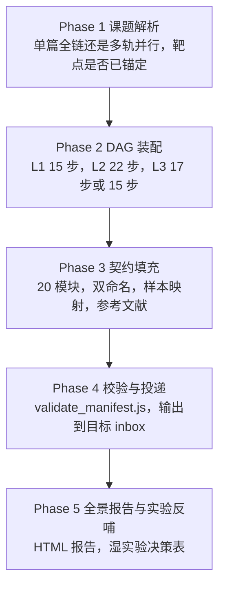

# 工作台需求单生成与全景交付 (geo-workbench-bridge)

本技能负责流水线第三段：**把筛选与下载结果翻译成目标系统能直接执行的需求单**。

它处理四类容易出错的地方：

1. 只导出 `modIds`，前端反查不到步骤，复选框全空。
2. 字段命名不统一，React 前端、Portal 与服务端各取一套，互相缺字段。
3. 空间转录组有虚拟敲除步骤，但没给靶基因，导入即被拦截。
4. 把两篇独立论文的数据硬塞进一个项目，后续无法拆分。

## 执行流程



### Phase 1：课题结构与靶点状态

必须先确认两件事，不能默认：

| 判断项 | 取值 | 处理 |
| :--- | :--- | :--- |
| 文章归属 | 单篇全链 | 一个项目，三条线依次递进 |
| 文章归属 | 多篇独立 | 每篇独立生成一份需求单，不混合 |
| 靶点状态 | 已送湿实验 | 锁定 `targetKoGene`，保留虚拟敲除与下游分析 |
| 靶点状态 | 待无偏筛选 | `targetKoGene` 留空，`isExploratory: true`，空间线自动降为 15 步 |

### Phase 2：DAG 装配

生成器按下表注入完整步骤，每步包含 `order`、`stepId`、`mod_id`：

| 分析线 | 步数 | 关键节点 |
| :--- | :---: | :--- |
| `line1_bulk` | 15 | 矩阵准备、QC、PCA、limma 差异、WGCNA、富集、PPI、机器学习、外部验证、cox、出图 |
| `line2_scrna` | 22 | 计数导入、细胞 QC、HVG、Harmony、聚类、注释、组成、亚群、拟时序、通讯、SCENIC、虚拟敲除、出图 |
| `line3_spatial` 靶点锚定 | 17 | 空间导入、QC、降维、域划分、共定位、通讯、注释、富集、空间敲除、下游分析、出图 |
| `line3_spatial` 无偏探索 | 15 | 去掉空间敲除与敲除下游分析，其余保留 |

### Phase 3：20 模块契约

生成器会同时写入 camelCase 与 snake_case，核心模块包括：

`manifest_version`、`projectId`、`lineId`、`basicInfo`、`dataSource`、`groupingDesign`、`pipelineDag`、`steps`、`biologicalPriors`、`phenotypeModules`、`analysisCutoffs`、`plotLayoutConfig`、`experimentalDesign`、`validationGroupMapping`、`wgcnaConfig`、`references`、`aclAndOutput`、`figure_templates`、`dataFiles`、`notes`。

字段语义与漏填后果见 [`references/workbench_manifest_spec.md`](references/workbench_manifest_spec.md)，机器可读版本见 [`schema/workbench-manifest.schema.json`](schema/workbench-manifest.schema.json)。

三条硬性约定：

- 公共数据库模式下，样本 ID 必须以 `GSM` 开头，且总量与 `dataSource.sampleCount` 一致。
- 每篇参考文献都必须带 `name`、`path`、`size`，否则前端列表会被过滤成 0 篇。
- 项目 ID 只允许字母、数字、下划线，默认由 `PRJ_分析线_YYYYMMDD_HHMMSS` 生成。

### Phase 4：校验与投递

先用仓库自带校验器：

```bash
node scripts/validate_manifest.js build/manifest.json
```

输出 `PASS` 表示 20 模块齐备、双命名一致、DAG 与标准步骤完全匹配、样本编号合法、靶基因与虚拟敲除匹配。

如需接入自己的系统，把 JSON 投递到目标目录即可。本仓库不绑定任何具体工作台路径：

```bash
python -c "import shutil,sys; shutil.copy(sys.argv[1], sys.argv[2])" build/manifest.json /path/to/target/inbox/manifest.json
```

### Phase 5：全景报告与实验反哺

报告是可选产物，建议包含：

- 三条分析线的递进关系与各自的数据依赖。
- 每个数据集的样本量、平台、原始数据等级与分数。
- 靶点状态与虚拟敲除策略。
- 下游湿实验决策表，参考 [`references/downstream_decision_matrix.md`](references/downstream_decision_matrix.md)。

HTML 报告建议自包含 CSS 与 Mermaid，不依赖外部 CDN，便于离线分享。

## 命令行

生成需求单：

```bash
node scripts/generate_full_manifest.js \
  --input examples/demo-bulk/config.json \
  --out-dir build
```

生成并立即校验：

```bash
node scripts/generate_full_manifest.js \
  --input examples/demo-bulk/config.json \
  --out-dir build \
  --validate
```

参数：

| 参数 | 说明 |
| :--- | :--- |
| `--input` | 必填，课题配置文件 |
| `--out` | 指定输出文件，优先于 `--out-dir` |
| `--out-dir` | 输出目录，默认 `build` |
| `--timestamp-name` | 文件名加 `YYYY-MM-DD_HHMMSS` 前缀，适配按文件名派生 ID 的系统 |
| `--validate` | 生成后立即执行校验 |

## 配置文件格式

最简配置只需要五块内容：

```json
{
  "name": "示例课题",
  "disease": "示例疾病",
  "species": "Homo sapiens",
  "lineId": "line1_bulk",
  "datasets": [{ "gse": "GSE245825", "gpl": "GPL18573", "sampleCount": 12, "role": "train" }],
  "groups": [
    { "groupName": "Control", "sampleIds": ["GSM1", "GSM2"] },
    { "groupName": "Disease", "sampleIds": ["GSM3", "GSM4"] }
  ]
}
```

其余字段会按 `references/workbench_manifest_spec.md` 补默认值。完整示例见 `examples/demo-bulk/config.json`。

## 适配外部系统

本技能只承诺两件事：生成符合本仓库 schema 的 JSON，以及给出可读的校验错误。目标系统如何消费这个 JSON 由你决定。

替换点只有两个：

- **输入适配器**：把上游报告与 `info.md` 转成配置文件，字段名可以不同，映射一次即可。
- **输出适配器**：把校验通过的 JSON 投递到目标 inbox，并调用目标系统自带的严格校验。

如果你有私有服务端校验函数，可以在 `--validate` 之后追加调用，但不建议把私有路径写进技能本体。

## 边界

- 不下载数据，不访问 GEO。
- 不执行 R 或 Python 分析流程，只生成需求。
- 不替用户判断两篇论文是否应该合并，必须显式确认。
